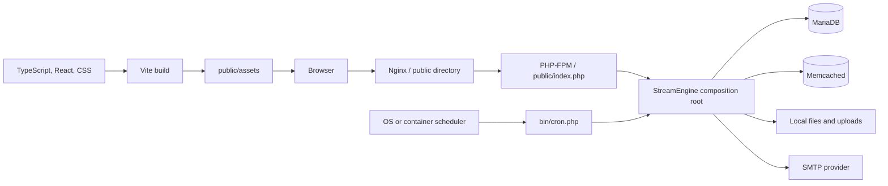
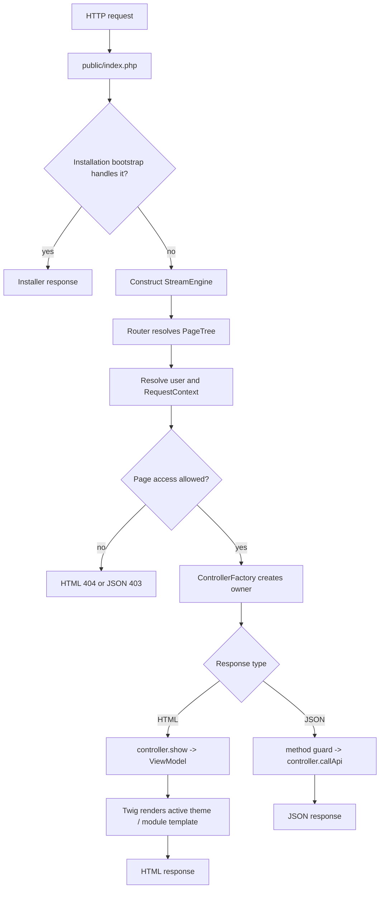

# Developer Guide: Architecture and request flow

Stream Engine is a modular PHP application with a server-rendered public site,
a React administration interface, database-backed routing, and controller-owned
extension points. This chapter explains the current implementation boundaries.
It describes what the code does today, not a proposed framework architecture.

## System boundaries

The web server exposes only `public/`. PHP owns application bootstrap, routing,
authorization, persistence, server rendering, and API dispatch. MariaDB stores
durable application state, Memcached accelerates selected lookups, and the
local filesystem stores configuration, runtime state, Twig cache files, and
uploads.



MinIO is present in the development Compose environment and an S3-compatible
client exists under `src/Core/ObjectStorage/`. The runtime `UploadService`
currently uses `FileStorage`; object storage is not an active upload backend.
Do not design a feature on the assumption that configuring the S3 environment
variables changes upload storage.

## Composition root

[`StreamEngine`](https://github.com/bfhp/stream-engine/blob/main/src/StreamEngine.php)
is the application composition root. Its constructor currently:

1. discovers module controllers;
2. reads deployment configuration from the environment;
3. connects to MariaDB and Memcached;
4. creates repositories and shared services;
5. loads the database-backed page tree and active theme;
6. gives shared dependencies to `ControllerFactory`;
7. lets modules register runtime pages, API routes, and cron tasks; and
8. validates the complete page definition set.

There is no general-purpose dependency-injection container. The composition
root constructs shared objects explicitly. `ControllerFactory` indexes those
objects by concrete class, parent class, and implemented interface, then uses
constructor reflection to inject them into a controller. It also supplies the
per-request `RequestContext` and `ModuleRegistry`.

A controller dependency is therefore available only when it is one of these:

- a shared service explicitly handed to `ControllerFactory` by the composition
  root;
- `RequestContext`;
- `ModuleRegistry`; or
- a constructor parameter with a default value.

An unknown or untyped required parameter fails controller construction. Adding
a new cross-module service requires an explicit composition-root decision and
tests; it is not made globally available by placing a class under `src/`.

## Layer ownership

| Area | Owns | Must not own |
| --- | --- | --- |
| `src/Core/` | Runtime infrastructure and shared contracts: configuration, routing, page tree, controller construction, security, cache, migrations, cron, themes, and file processing. | Feature-specific behavior or imports from a module namespace. |
| `src/Domain/` | Shared domain values passed between repositories, services, controllers, and views. | Fields meaningful to only one module. |
| `src/Repository/` | Shared SQL queries, persistence mapping, and transaction-facing operations. | HTTP responses, templates, or feature presentation. |
| `src/Service/` | Shared application operations used by more than one feature. | Module-private workflows or browser rendering. |
| `src/Modules/<Name>/` | One feature's controllers, private services and repositories, templates, route declarations, API handlers, and cron handlers. | Imports from another module or changes that make platform code depend on the module. |
| `src/View/` and `src/Twig/` | View models, breadcrumbs, Twig integration, and template modification tracking. | Persistence or feature policy. |
| `views/themes/` | Site layouts, shared presentation, theme assets, and allowed template overrides. | Module business logic. |
| `assets-src/` | Browser behavior, React administration code, styles, shared frontend utilities, and Vite entry points. | Server authorization or trusted validation. |

The central dependency rule is one-way:

```text
module -> Core / Service / Repository / Domain
platform -X-> module
module A -X-> module B
```

If two modules need the same capability, move a suitably general contract or
service into the shared platform. If only one module needs it, keep it private
and construct it from dependencies already provided to that module. Deleting a
module must not prevent unrelated features from booting.

The normative dependency and extension contract is documented in
[Modules](https://github.com/bfhp/stream-engine/wiki/Developer-Modules).

## HTTP bootstrap

Every web request enters through
[`public/index.php`](https://github.com/bfhp/stream-engine/blob/main/public/index.php):

1. Composer autoloading is required.
2. `.env` is loaded without replacing environment variables already supplied
   by the process.
3. `WebInstallationBootstrap` handles an uninstalled site or allows normal
   execution to continue.
4. A new `StreamEngine` instance is composed and handles the request.
5. An exception that escapes normal request handling becomes a minimal JSON or
   HTML `500` response and is written to the PHP error log.

The application is currently composed for each PHP request. Services may cache
data during that request, but developers must not assume that an object remains
alive across requests. In `APP_ENV=dev`, the configured Memcached service is
flushed when `StreamEngine` is constructed, not only the active key prefix.
Development must therefore not share that service with valuable environments.
This behavior favors predictable development over cache-performance realism.

## Request lifecycle



### Build the page tree

At bootstrap, `PageRepository` loads administrator-configured pages from
MariaDB into `PageTree`. Modules may add fixed internal pages through
`registerRuntimePages()`, then the engine adds `/api`, `/api/v1`, and `/admin`
and lets modules register API pages. Page IDs, actions, parents, static
patterns, dynamic patterns, and hierarchy cycles are validated after all
definitions have been collected.

`Router` walks URL segments through this hierarchy. A static child wins before
a dynamic child. A dynamic pattern such as `{slug}` or `{id:\d+}` contributes
named route parameters. The result contains the final `Page`, all named
parameters, and the resolved page chain used for breadcrumbs.

The page tree is also the basis for canonical URL generation. `UrlGenerator`
maps actions, feed bindings, feed types, term vocabularies, and route
parameters back to paths. Developers should use it instead of assembling URLs
from known route strings. The normative pattern, binding, and URL-generation
contract is documented in
[Pages and routing](https://github.com/bfhp/stream-engine/wiki/Developer-Pages-and-Routing).

### Establish request identity

`AuthService` resolves the current user. The engine then creates an immutable
`RequestContext` containing:

- the current `User`;
- the user's `DateTimeZone`; and
- a `QueryParams` snapshot copied from `$_GET` at request start.

Controllers should use the injected context for these values. `QueryParams`
provides typed, testable accessors and treats arrays or invalid scalar values
as absent instead of coercing them.

Page access is checked before controller dispatch. Inaccessible HTML pages are
rendered as `404` so their existence is not disclosed; JSON routes produce a
forbidden response. This page-level check does not replace action-specific
authorization, ownership checks, request-method declarations, or CSRF checks
inside mutating handlers.

### Resolve and call the controller

Every routable page has an action. `ModuleRegistry` maps actions to the module
controller that declared them, and `ControllerFactory` creates that controller
with the current request context.

For HTML pages, `show(Page, params)` returns a `ViewModel` containing a Twig
template name and data. The engine adds shared menus, user and site data,
widgets, theme metadata, breadcrumbs, and request runtime before rendering.

For non-HTML pages, the engine verifies the page's declared HTTP methods and
calls `callApi(Page, params)`. The current API controller contract writes the
response; it does not return a response object. The API and security chapter
will document response bodies, authentication, CSRF, and validation in detail.

## Templates and themes

Twig searches templates in this order:

1. the active theme;
2. each parent theme;
3. the built-in `default` theme; and
4. module view directories.

Each theme and module also receives a Twig namespace, allowing an override to
extend or include the template it replaces without recursively selecting
itself. Module template paths should still be unique and explicit.

`CachedEnvironment` records the modification time of templates loaded during
rendering. The engine combines this with the latest settings update and emits
`Last-Modified`; this is metadata, not a complete page-response cache. Twig's
compiled-template cache is stored in the configured Twig cache directory and
automatically reloads templates in development.

If a non-default theme throws a Twig loading, syntax, or runtime error, the
request is retried with the default theme and the failure is logged. A failure
in the default theme is not hidden.

The normative discovery, manifest, inheritance, asset, ownership, override,
and browser UI contracts are documented in
[Themes](https://github.com/bfhp/stream-engine/wiki/Developer-Themes).

## Persistence, settings, and cache

`PdoDatabase` is the shared PDO wrapper. It uses native prepared statements,
exception error mode, associative fetches, UTF-8, and a strict MariaDB SQL
mode. Repositories own SQL and map rows into domain or service-facing data.
Services coordinate access rules and operations across repositories.

Use transactions around multi-write invariants. A service should not place SQL
in a controller merely because the controller already receives `PdoDatabase`;
choose a shared or module-private repository according to ownership.

Deployment configuration such as database credentials, cache endpoints,
filesystem paths, SMTP credentials, and `APP_SECRET` comes from `.env` through
`Config`. Administrator-editable site settings live in MariaDB and are loaded
through `SettingsService`. Do not put a deploy-time secret into the settings
table or hard-code a site setting into an environment lookup.

`Cache` provides namespaced Memcached keys with an in-process fallback. Cache
entries are disposable accelerators; MariaDB and persistent files remain the
source of truth. `UrlGenerator` is one current cache consumer. Features must
remain correct after cache loss and must define invalidation when cached data
depends on a write.

## Module discovery and extension points

`ModuleRegistry` reads Composer's optimized classmap and registers every
concrete class implementing `ControllerInterface`. It does not scan module
directories directly. Adding or renaming a controller therefore requires:

```bash
composer dump-autoload
```

A controller may contribute:

- administrator-configurable page actions and feed types;
- module-owned runtime pages;
- API pages;
- scheduled tasks;
- breadcrumb data;
- HTML view models and API handlers; and
- dashboard cards when it implements the corresponding provider interface.

Module identifiers, action names, feed types, routes, and dashboard-card IDs
are global contracts and are checked for supported shapes or collisions during
bootstrap. Discovery does not automatically expose a public page: a page
action still needs a configured database page, while fixed subordinate routes
belong in runtime-page registration.

## Frontend architecture

Vite builds multiple explicit entry points from `assets-src/` into stable
paths under `public/assets/`:

- `site` initializes shared public-site browser behavior;
- `admin` mounts the React administration application;
- page-specific entries load behavior only where the controller or template
  includes them; and
- Bootstrap, RTL, skin, and UI-adapter entries support theme composition.

The administration interface uses React Router's `HashRouter`. PHP serves the
admin shell at `/admin`; client routes live after `#` and API authorization is
still enforced on the server.

The build also executes PHP-backed Vite plugins to derive browser translation
catalogs and registered feed types from server sources. Composer dependencies
and a working PHP executable are therefore build-time frontend dependencies.
Optional site modules may add top-level `.ts` or `.tsx` entries under
`modules/<Name>/assets/`; their output names must not collide with engine or
other module entries.

The application references compiled `/assets/` paths. Keep PHP/templates and
their matching assets in the same deployment and rebuild after changing an
entry point, translation catalog, module registration, or imported source.
The complete source ownership, entry-point, runtime integration, admin
extension, localization, test, and generated-asset contract is documented in
[Frontend development](https://github.com/bfhp/stream-engine/wiki/Developer-Frontend).

## Background-task flow

`bin/cron.php` loads the same environment and constructs the same
`StreamEngine` composition root as a web request. During bootstrap, controllers
register task names, owning controller IDs, and intervals in `CronRegistry`.

For a scheduled run, the CLI entry point takes a non-blocking filesystem lock
to prevent overlapping scheduler processes. `CronRunner` then checks each
task's interval and acquires the database-backed per-task lock before creating
the owner through `ControllerFactory` and calling `runCron(task)`.

Manual execution with `--task` skips the scheduler-wide lock and interval but
still uses the per-task lock. Cron controllers receive a request context with
the guest user, UTC timezone, and an empty query-parameter bag. A task must not
rely on browser state, an authenticated user, or an active HTTP request.

## Errors and response safety

Expected request failures use `ValidationException` or its specialized
not-found and forbidden subclasses. They carry an HTTP status, client-safe
message, and stable code. Unexpected `Throwable` values are treated as bugs:
they are logged and become a generic `500` response without exposing the
exception message to the client.

HTML errors render through the active theme, with the same default-theme
fallback. JSON errors use the shape `{ "error": string, "code": string }`.
Code that catches an exception locally must either recover fully or preserve
this distinction between expected client errors and internal faults.

## Placement checklist

Before adding a class or dependency, ask:

1. Is it deployment infrastructure or a shared runtime contract? Put it in
   `Core`.
2. Is it a reusable application operation needed by several modules? Put it
   in `Service`, backed by shared repositories or domain values as needed.
3. Is it persistence used by several features? Put it in `Repository`.
4. Is it meaningful to one module only? Keep it inside that module and do not
   wire it into the global composition root.
5. Is it presentation? Keep the server view model small and place markup in
   the owning module or theme, and browser behavior in `assets-src/` or the
   site's module assets.
6. Does the change cross an existing contract? Update the relevant guide and
   add tests at the boundary, not only inside the new class.

[Back: Getting started](https://github.com/bfhp/stream-engine/wiki/Developer-Getting-Started) · [Developer Guide](https://github.com/bfhp/stream-engine/wiki/Developer-Guide) · [Next: Database and migrations](https://github.com/bfhp/stream-engine/wiki/Developer-Database-and-Migrations)
